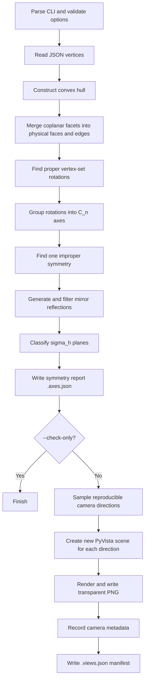

# Convex Polyhedron Symmetry Analyzer & Renderer

**Detect the rotational and reflection symmetries of a convex 3D polyhedron, then render its physical geometry, rotation axes, and mirror planes from reproducible camera viewpoints.**

This project is a Python command-line tool for geometric symmetry analysis and publication-style visualization. It reads a set of 3D vertices from JSON, reconstructs the convex polyhedron, computes genuine vertex-set symmetries, classifies horizontal mirror planes (\(\sigma_h\)) with respect to selected rotational axes, and produces transparent PNG figures together with machine-readable analysis and camera metadata.

The application deliberately separates **what is mathematically present** from **what is drawn**: all supported symmetries are detected before choosing which axes and mirror planes to display. A colorful plane in a screenshot is therefore intended to represent a verified geometric reflection symmetry, not a decorative or visually guessed section.

> **Source of truth:** This README documents the current behavior of `render_polyhedron_v5p0.py` and its comment-rich counterpart `render_polyhedron_v5p0_FULLY_DOCUMENTED.py`. The latter is intended for readers who want to understand, troubleshoot, or modify the implementation without changing the underlying algorithm.

## Contents

1. [Features at a glance](#features-at-a-glance)
2. [Repository files and requirements](#repository-files-and-requirements)
3. [Installation](#installation)
4. [Input JSON format](#input-json-format)
5. [Quick start](#quick-start)
6. [What the program actually does](#what-the-program-actually-does)
7. [Mathematical foundations](#mathematical-foundations)
8. [Rendering and visual conventions](#rendering-and-visual-conventions)
9. [Complete command-line reference](#complete-command-line-reference)
10. [Output files and JSON schemas](#output-files-and-json-schemas)
11. [Worked example: a cube](#worked-example-a-cube)
12. [Practical rendering recipes](#practical-rendering-recipes)
13. [Developer guide: where to change what](#developer-guide-where-to-change-what)
14. [Safe extension workflow](#safe-extension-workflow)
15. [Limitations and implementation caveats](#limitations-and-implementation-caveats)
16. [Troubleshooting](#troubleshooting)
17. [Validation checklist](#validation-checklist)
18. [Terminology](#terminology)

---

## Features at a glance

- **Geometry-aware input:** Loads 3D vertices from several JSON key conventions and constructs their convex hull.
- **Clean physical faces:** Merges coplanar hull triangles into polygonal faces so artificial triangulation diagonals are not drawn as physical edges.
- **Verified proper rotations:** Discovers 3 × 3 rotation matrices by matching vertex configurations and validating the entire transformed vertex set.
- **Rotation-axis analysis:** Groups nonidentity rotations into undirected \(C_n\) axes, reporting rotational orders and directions.
- **Verified reflection planes:** Identifies reflection operations from improper orthogonal symmetries; does not infer mirrors merely from facial appearance.
- **Configurable \(\sigma_h\) convention:** Classifies horizontal mirrors relative to highest-order axes, all axes, or one numbered axis.
- **Flexible mirror-plane graphics:** Rectangle, disc, square, or extended cross-sectional polygon.
- **Distinct axis-order colors:** The standard palette emphasizes \(C_2\), \(C_3\), \(C_4\), and \(C_5\) with different dark colors.
- **Transparent renders:** Saves RGBA PNGs suitable for figures, slides, or compositing.
- **Reproducible randomized views:** Samples directions uniformly over the sphere; `--seed` reproduces the direction sequence.
- **Separate scene per output:** Recreates the PyVista render window for every view and checks for duplicate pixel buffers.
- **Analysis-only mode:** `--check-only` performs the mathematical analysis and writes a JSON report without creating images.

## Repository files and requirements

### Core scripts

| File | Purpose |
| --- | --- |
| `render_polyhedron_v5p0.py` | Original executable implementation. |
| `render_polyhedron_v5p0_FULLY_DOCUMENTED.py` | Same executable logic with extensive inline explanations, modification guidance, and implementation caveats. |
| `README.md` | Setup, usage, pipeline, reference, customization, and troubleshooting documentation (this file). |
| `shape.json` | **User-supplied** example name for a JSON file containing 3D vertices. The application does not generate this input. |

Both Python scripts can be invoked in the same way. Unless otherwise specified, examples below use the documented version. Substitute `render_polyhedron_v5p0.py` if you prefer the original.

### Technology stack

| Component | Role |
| --- | --- |
| Python 3.8+ | CLI, control flow, file operations, output metadata. |
| NumPy | Vectors, matrices, numerical tolerances, SVD, geometry calculations. |
| SciPy `scipy.spatial.ConvexHull` | Convex hull and triangulated boundary geometry. |
| SciPy `scipy.spatial.cKDTree` | Efficient nearest-neighbor verification of transformed vertices. |
| SciPy `scipy.spatial.transform.Rotation` | Rotation-matrix to axis-angle conversion. |
| PyVista (using VTK) | Mesh construction, lighting, camera controls, transparency, PNG screenshots. |

The source does **not** specify pinned dependency versions. A Python 3.8+ interpreter is indicated in its module documentation, but current package releases may have their own higher Python requirements. If installation fails, select compatible NumPy/SciPy/PyVista versions for your interpreter.

### Suggested local layout

```text
polyhedron-symmetry/
├── README.md
├── render_polyhedron_v5p0.py
├── render_polyhedron_v5p0_FULLY_DOCUMENTED.py
├── shapes/
│   └── cube.json                   # You create or supply this input
└── output/                        # Automatically created as needed
    ├── cube.axes.json
    ├── cube.views.json
    ├── cube_view_001.png
    └── ...
```

This is a suggested layout, **not a claim that the repository currently contains all these directories or sample files**.

## Installation

### 1. Create a virtual environment

On macOS or Linux:

```bash
python3 -m venv .venv
source .venv/bin/activate
```

On Windows PowerShell:

```powershell
py -m venv .venv
.venv\Scripts\Activate.ps1
```

### 2. Install the dependencies

```bash
python -m pip install --upgrade pip
python -m pip install numpy scipy pyvista
```

A working rendering environment additionally needs the graphics dependencies used by VTK/PyVista. On desktop systems, this usually means a working OpenGL-capable environment. Headless servers, containers, and CI systems may require a suitable off-screen backend or virtual display; the script itself does not configure one.

### 3. Verify that the CLI is available

```bash
python render_polyhedron_v5p0_FULLY_DOCUMENTED.py --help
```

For analysis-only workflows, **PyVista is imported lazily** inside `create_scene()`. As a result, the geometric analysis can run in `--check-only` mode with NumPy and SciPy available even if PyVista has not been installed. PNG generation requires PyVista.

## Input JSON format

The required geometry is an array of **at least four finite points**, each containing exactly three numeric coordinates:

\[
\mathbf{v}_i = (x_i, y_i, z_i), \qquad i=1,\ldots,N.
\]

### Minimal example: a cube

Create `shapes/cube.json`:

```json
{
  "name": "Example cube",
  "vertices": [
    [-1, -1, -1],
    [-1, -1,  1],
    [-1,  1, -1],
    [-1,  1,  1],
    [ 1, -1, -1],
    [ 1, -1,  1],
    [ 1,  1, -1],
    [ 1,  1,  1]
  ]
}
```

The points may appear in any order. You do not need to supply faces, edges, surface normals, or symmetry axes: these are derived by the script.

### Accepted vertex keys

`read_vertices()` attempts the following keys in order:

1. `vertices`
2. `8_vertices`
3. `12_vertices`
4. `polyhedron_vertices`
5. Other top-level names ending in `_vertices`

The reader tries these names in order and selects the **first successfully shaped \(N\times3\) array**. It converts candidate values to floating-point numbers, so a present key containing nonnumeric text may raise a conversion error instead of falling through to later keys. The reader also uses the optional name field `1_Name`, otherwise `name`, otherwise the fallback `polyhedron` for the report.

### Input constraints

- The coordinates must be convertible to floating-point numbers and contain no `NaN` or infinite values.
- There must be at least four points, but they must also span a **nondegenerate three-dimensional convex hull**. Four coplanar points are not sufficient.
- Only vertices of the resulting convex hull participate in symmetry detection. Any supplied interior or otherwise non-hull points are removed.
- Faces are **not** read from JSON; they are reconstructed from the convex hull.
- The physical object being studied is therefore the **convex hull** of the supplied coordinates, not an arbitrary nonconvex mesh.
- Absolute coordinate scale is usually less important than relative geometry, but very small, enormous, nearly coplanar, or noisy coordinates can aggravate floating-point problems.

## Quick start

### A. Analyze symmetry without rendering

```bash
python render_polyhedron_v5p0_FULLY_DOCUMENTED.py \
    shapes/cube.json \
    --check-only \
    --output output/cube.png
```

This produces `output/cube.axes.json` and prints the detected geometry and symmetries. It does **not** produce PNG views or a `.views.json` manifest.

### B. Render several transparent images

```bash
python render_polyhedron_v5p0_FULLY_DOCUMENTED.py \
    shapes/cube.json \
    --n-views 10 \
    --seed 42 \
    --output output/cube.png \
    --resolution 2400
```

The `--output` path is a **prefix template**, not the name of a single saved image. The script writes `cube_view_001.png`, `cube_view_002.png`, and so on in the chosen directory, plus the analysis report and camera manifest.

### C. Display every reflection plane

```bash
python render_polyhedron_v5p0_FULLY_DOCUMENTED.py \
    shapes/cube.json \
    --n-views 4 \
    --seed 42 \
    --output output/cube_all_mirrors.png \
    --plane-mode all \
    --show-legend
```

### D. Choose one rotational axis as the horizontal reference

First run `--check-only` and inspect the numbered axes in the console or `*.axes.json` report. Then choose a **1-based** index:

```bash
python render_polyhedron_v5p0_FULLY_DOCUMENTED.py \
    shapes/cube.json \
    --n-views 3 \
    --output output/cube_one_reference.png \
    --principal-axis-index 1 \
    --plane-mode horizontal
```

A nonexistent index raises an error rather than silently changing the convention.

## What the program actually does



### Function-by-function guide

| Function | Responsibility | What it returns or changes |
| --- | --- | --- |
| `parse_arguments()` | Defines and parses all command-line switches. | An `argparse.Namespace`. |
| `main()` | Validates options and orchestrates analysis, reporting, and optional rendering. | Side effects: console messages and output files. |
| `read_vertices()` | Locates input vertex data, checks shape and finiteness, removes non-hull points. | Source JSON, hull vertices, reference center, `ConvexHull`. |
| `polygon_faces_from_hull()` | Combines triangles on the same geometric plane; orders polygon boundaries. | Flat VTK face cells, actual edge pairs, face count. |
| `find_proper_rotations()` | Generates candidate determinant-\(+1\) matrices and verifies global vertex-set mappings. | Proper symmetry rotation matrices, including identity. |
| `symmetry_axes()` | Extracts angle/axis from nonidentity rotations and groups them by common axis. | Axis dictionaries with direction, order, and angles. |
| `find_one_improper_symmetry()` | Searches for one determinant-\(-1\) orthogonal vertex-set symmetry. | One matrix, or `None`. |
| `find_mirror_planes()` | Builds improper operations from the proper group, then keeps genuine reflections. | Unique mirror-plane normals. |
| `classify_mirror_planes()` | Finds which mirrors are perpendicular to selected rotational axes. | Enriched mirror-plane dictionaries containing \(\sigma_h\) flags and axis indices. |
| `canonical_axis()` | Normalizes a vector and selects a reproducible sign for an undirected line. | Canonical unit vector. |
| `save_report()` | Serializes numerical symmetry findings. | `.axes.json` file and corresponding Python dictionary. |
| `random_camera_directions()` | Uniformly samples sphere directions using an optional seed. | Array of unit directions. |
| `set_camera_for_direction()` | Positions a parallel-projection camera with a consistent scale. | Camera position and up vector. |
| `create_scene()` | Constructs geometry, mirror patches, axis tubes, materials, lights, and labels. | New PyVista plotter, body radius, axis half-length. |
| `render_images()` | Creates a fresh scene per view, captures RGBA PNGs, and logs camera settings. | PNGs and `.views.json` manifest. |

### Common data objects

| Name | Meaning |
| --- | --- |
| `vertices` | `float` array with shape `(N, 3)`; convex-hull vertices. |
| `center` | Mean of the retained hull vertices. Not the volume centroid. |
| `radius` | Maximum distance between `center` and a retained vertex. Used for relative scaling. |
| `faces` | Flat connectivity list: `[n, id0, ..., id(n-1), n, ...]` in VTK polygon-cell format. |
| `edges` | Sorted unique pairs of vertex indices representing actual polygon edges. |
| `operations` / `rotations` | Proper \(3\times3\) symmetry matrices. |
| `axes` | Records containing `direction`, `order`, and `angles_degrees`. |
| `planes` | Records containing `normal`, `is_sigma_h`, and reference-axis index lists. |
| `args` | CLI settings, passed into scene construction and rendering. |

## Mathematical foundations

### 1. Convex hull and the reference center

`scipy.spatial.ConvexHull` determines the outer boundary of the supplied point set. It supplies triangular facets, but a quadrilateral or pentagonal physical face is still one face. `polygon_faces_from_hull()` groups coplanar hull triangles using face normal and offset comparisons, then orders their boundary vertices by angle in a local in-plane coordinate system.

The symmetry center used by the code is:

\[
\mathbf{c}=\frac{1}{N}\sum_{i=1}^{N}\mathbf{v}_i.
\]

Here \(N\) counts **retained hull vertices**. This point is the centroid of the finite vertex set; it need not equal the volume centroid of the solid. Every exact symmetry that permutes the vertex set fixes its arithmetic mean, which makes this center a natural reference for symmetry analysis.

Centered vertices are \(\mathbf{p}_i=\mathbf{v}_i-\mathbf{c}\), and the scale used for relative sizes and symmetry tolerance is:

\[
R=\max_i\|\mathbf{p}_i\|.
\]

### 2. Proper rotational symmetry

A proper rotation is represented by an orthogonal matrix \(M\) satisfying

\[
M^\mathsf{T}M=I,\qquad\det(M)=+1.
\]

It is a symmetry of the polyhedron if transforming every centered vertex maps the complete vertex set onto itself, within numerical tolerance.

Rather than guessing rotation axes or trying a hardcoded list of angles, `find_proper_rotations()`:

1. Selects three independent, well-separated anchor vectors from the centered vertices.
2. Uses squared radii and pairwise dot products (a **Gram matrix**) to shortlist possible image triples with compatible geometry.
3. Computes an orthogonal alignment using singular value decomposition (SVD), with a determinant correction that forces a **proper** rather than improper transformation.
4. Transforms **every** vertex by the candidate matrix.
5. Queries a `cKDTree` to confirm that all transformed vertices lie close to original vertices **and** match distinct destination points.
6. Removes duplicate transformation matrices, ensures identity is included, and tests group closure under matrix multiplication.

The global verification step matters. Matching only three points can suggest a transformation that does **not** preserve the rest of the polyhedron.

The absolute nearest-neighbor matching tolerance is computed from the relative CLI parameter:

\[
\varepsilon_{\mathrm{absolute}}=\texttt{symmetry\_tol}\times R.
\]

The code additionally uses scale-dependent tolerances when comparing Gram-matrix quantities.

### 3. Rotational axes and their orders

Each nonidentity proper rotation is converted to axis-angle form using SciPy's `Rotation` class. A direction \(\hat{\mathbf{a}}\) and its negative represent the **same undirected axis line** through the center.

Rotations sharing the same axis line are grouped together. For a finite cyclic rotation subgroup of order \(n\), there are \(n-1\) nonidentity rotations about that line, so the script determines:

\[
\text{order}=\#(\text{nonidentity rotations about the line})+1.
\]

Examples:

| Axis | Smallest positive rotation angle | Interpretation |
| --- | ---: | --- |
| \(C_2\) | 180° | Twofold rotation symmetry. |
| \(C_3\) | 120° | Threefold rotation symmetry. |
| \(C_4\) | 90° | Fourfold rotation symmetry. |
| \(C_5\) | 72° | Fivefold rotation symmetry. |
| \(C_6\) | 60° | Sixfold rotation symmetry. |

The report also stores all detected nonidentity rotation angles for each axis. The identity operation is included in the rotation-group count but is **not drawn as an axis**.

### 4. Improper symmetries and real mirror planes

Improper orthogonal matrices have determinant \(-1\), but **not all improper operations are mirror reflections**. They can also include inversion or rotary reflections.

`find_one_improper_symmetry()` uses the same anchor-triplet approach, with the SVD correction chosen to enforce determinant \(-1\). If an improper symmetry \(Q_0\) is found, all improper elements are generated as:

\[
Q = M Q_0,\qquad M\in G_+,
\]

where \(G_+\) is the detected proper rotation group. This works because the improper symmetries, when they exist, form a coset of the proper group.

`find_mirror_planes()` retains only transformations satisfying the reflection characteristics:

\[
\det(Q)=-1,\qquad \operatorname{tr}(Q)=1,\qquad Q^2\approx I.
\]

A plane reflection has eigenvalues \((+1,+1,-1)\). The eigenvector associated with \(-1\) is the unit normal \(\hat{\mathbf{n}}\) to its mirror plane:

\[
\hat{\mathbf{n}}\cdot(\mathbf{x}-\mathbf{c})=0.
\]

Both \(\hat{\mathbf{n}}\) and \(-\hat{\mathbf{n}}\) describe the same physical plane. Duplicate normals are therefore consolidated.

### 5. What “horizontal” (\(\sigma_h\)) means here

A geometric mirror is classified as \(\sigma_h\) when its **normal is parallel to a reference rotation axis**; equivalently, the mirror plane itself is **perpendicular** to that axis.

This designation is **relative to the selected reference convention**, not to the screen's horizontal direction or the world's \(z\)-axis:

- `--horizontal-reference maximum` (default) uses **every axis of highest rotational order**. This can produce multiple \(\sigma_h\) planes for highly symmetric shapes.
- `--horizontal-reference all` uses every detected nonidentity \(C_n\) axis as a possible reference; this is intentionally a broader, nonstandard convention.
- `--principal-axis-index K` overrides those choices and uses only the **Kth axis in the printed, 1-based axis list**.

If the object has no nontrivial rotational axes, the implementation does **not** label a plane \(\sigma_h\), even if reflection planes exist.

**Important distinction:** `--plane-mode` affects which **detected** planes are rendered; `--horizontal-reference` and `--principal-axis-index` affect which are **classified** as horizontal. These settings do different jobs.

## Rendering and visual conventions

### Polyhedron body and edges

`create_scene()` constructs a `pyvista.PolyData` surface from the original hull vertices and the merged polygon faces. It renders the body with flat face shading, adjustable opacity, and its own material settings. Physical edges are drawn separately from the polygon boundary list so triangulation artifacts do not show as false edges.

Default colors are a blue body (`#7098B7`) and pale edges (`#DCE8F0`). The actual **default body opacity is `0.50`**, so the object is translucent by default even though the original module summary mentions an opaque-body visual style.

### Rotational axis cylinders

For each detected \(C_n\) axis, the renderer creates a cylinder centered at \(\mathbf{c}\), aligned with its unit direction, with spherical end caps. The key dimensions are relative to the body radius \(R\):

\[
\text{cylinder height}=2\times\texttt{axis\_length}\times R.
\]

The requested cylinder-radius scale is `axis_thickness × R`; the actual cylinder radius receives an additional factor of **1.35** for orders greater than 2, or **1.22** for \(C_2\). This is intentional code behavior and matters when fine-tuning an illustration.

Default axis-order palette:

| Rotation order | Hex color | Description |
| --- | --- | --- |
| \(C_2\) | `#5B2C83` | Dark purple. |
| \(C_3\) | `#B85C00` | Dark orange. |
| \(C_4\) | `#1B5E20` | Dark green. |
| \(C_5\) | `#6D4C41` | Dark brown. |
| \(C_6\) | `#1F4E79` | Dark blue. |
| Other orders | `#37474F` | Configurable fallback unless a new order override is implemented. |

### Mirror-plane patches

The actual mathematical reflection plane is infinite. The **visible patch** is only a finite illustration of it:

| `--plane-style` | Construction and intended effect | Primary size control |
| --- | --- | --- |
| `rectangle` (default) | Physically oriented patch aligned with the projected object geometry; minimum aspect ratio is enforced. | `--plane-span`, `--plane-aspect`. |
| `square` | Square in a deterministic local plane basis. | `--plane-span` relative to \(R\). |
| `disc` | Circular polygonal patch, with configurable segment count. | `--plane-span`, `--plane-resolution`. |
| `section` | Intersection of the actual convex body with the plane, expanded slightly beyond the body. | `--plane-extension`. |

The code draws the plane fill and its boundary separately. A boundary is a small **3D tube**, so its visible thickness is governed by `--plane-border-radius` rather than the currently unused `--plane-edge-width` option.

Default \(\sigma_h\) fill and outline are teal (`#66D1C7` and `#8FF5EA`); other mirror fills and outlines are muted purple (`#C6B8DE` and `#9585B2`). The fill opacity defaults are intentionally low to allow overlapping geometry to remain legible.

### Viewpoint sampling and camera consistency

`random_camera_directions()` samples an azimuth uniformly over \([0,2\pi)\) and \(z=\cos\theta\) uniformly over \([-1,1]\). This produces isotropic view directions on the unit sphere; directly sampling the polar angle uniformly would overrepresent the poles.

For each direction, `set_camera_for_direction()`:

1. Normalizes the direction vector.
2. Places the camera at \(\mathbf{c}+5R\hat{\mathbf{d}}\).
3. Aims it at the reference center.
4. Chooses a stable view-up vector, using an alternative near the poles.
5. Enables parallel/orthographic projection.
6. Sets a common parallel scale based on the body radius and symmetry-axis length.

`render_images()` then forces a camera update and a fresh render before capturing a transparent RGBA screenshot. A SHA-256 hash of each returned pixel buffer helps detect accidentally duplicated frames. It subsequently closes the plotter before moving on to the next view.

## Complete command-line reference

You can inspect the live parser with:

```bash
python render_polyhedron_v5p0_FULLY_DOCUMENTED.py --help
```

### Input, output, and execution

| Argument | Default | Meaning |
| --- | --- | --- |
| `shape_json` | Required | Positional path to the input vertex JSON. |
| `--output PATH.png` | `polyhedron_symmetry.png` | File stem used for view PNGs and default JSON report paths. Must end in `.png`. |
| `--report PATH` | Derived from `--output` | Overrides **only** the symmetry report path. |
| `--check-only` | Off | Runs detection, prints results, writes `.axes.json`; skips rendering and camera manifest. |
| `--n-views N` | Prompt if terminal | Positive integer number of camera renders. **Required** when noninteractive unless `--check-only` is set. |
| `--seed N` | `None` | Seed for reproducible random directions. |
| `--interactive` | Off | Opens an interactive preview on the first iteration, then proceeds with scripted screenshots. |

### Polyhedron appearance and image dimensions

| Argument | Default | Meaning |
| --- | --- | --- |
| `--resolution N` | `2400` | Image width; minimum 256. |
| `--height N` | Same as width | Optional image height; minimum 256. |
| `--face-color COLOR` | `#7098B7` | Surface color. |
| `--edge-color COLOR` | `#DCE8F0` | Physical-edge color. |
| `--opacity X` | `0.50` | Body opacity between 0 and 1. |
| `--edge-width X` | `1.8` | Display width of physical-edge lines. |

### Rotation detection, axis geometry, and axis colors

| Argument | Default | Meaning |
| --- | --- | --- |
| `--symmetry-tol X` | `1e-6` | Relative geometric tolerance for vertex-set symmetry matching. Must be positive. |
| `--axis-length X` | `1.45` | Axis **half-length** divided by body radius; the full cylinder is twice this length. |
| `--axis-thickness X` | `0.018` | Nominal axis-cylinder radius divided by body radius; renderer applies an extra order-based multiplier. |
| `--axis-opacity X` | `1.0` | Axis cylinder and cap opacity in `[0, 1]`. |
| `--c2-color COLOR` | `#5B2C83` | Twofold axis color. |
| `--c3-color COLOR` | `#B85C00` | Threefold axis color. |
| `--c4-color COLOR` | `#1B5E20` | Fourfold axis color. |
| `--c5-color COLOR` | `#6D4C41` | Fivefold axis color. |
| `--c6-color COLOR` | `#1F4E79` | Sixfold axis color. |
| `--axis-color-fallback COLOR` | `#37474F` | Used for other rotational orders not explicitly supported by a CLI override. |

### Mirror detection, classification, and visibility

| Argument | Default | Meaning |
| --- | --- | --- |
| `--plane-mode {horizontal,all,none}` | `horizontal` | Draw only classified \(\sigma_h\), all detected mirrors, or no mirror patches. |
| `--horizontal-reference {maximum,all}` | `maximum` | Choose maximal-order axes or all detected axes as horizontal references. |
| `--principal-axis-index K` | `None` | Optional **1-based** axis index overriding the reference mode. |
| `--plane-style {rectangle,disc,square,section}` | `rectangle` | Geometry of the finite plane illustration. |
| `--plane-color COLOR` | `#66D1C7` | Horizontal-mirror fill color. |
| `--plane-edge-color COLOR` | `#8FF5EA` | Horizontal-mirror border color. |
| `--plane-opacity X` | `0.08` | Horizontal-mirror fill opacity in `[0, 1]`. |
| `--plane-edge-opacity X` | `0.55` | Horizontal-mirror border opacity in `[0, 1]`. |
| `--plane-extension X` | `1.10` | Scale of a `section` patch relative to its body intersection. |
| `--plane-span X` | `1.15` | Scale factor used for rectangular, square, and disc patches. |
| `--plane-aspect X` | `1.22` | Rectangle's minimum length/width extent ratio; must exceed 1. |
| `--plane-border-radius X` | `0.006` | Radius of the actual 3D border tubes, as a fraction of body radius. |
| `--plane-resolution N` | `96` | Number of segments approximating the `disc` outline; at least 12. |
| `--other-plane-color COLOR` | `#C6B8DE` | Fill for mirrors not classified as horizontal. |
| `--other-plane-edge-color COLOR` | `#9585B2` | Border for mirrors not classified as horizontal. |
| `--other-plane-opacity X` | `0.11` | Nonhorizontal mirror fill opacity in `[0, 1]`. |

**Declared but not operative as their names suggest:**

| Argument | Current behavior |
| --- | --- |
| `--plane-edge-width X` (default `1.4`) | Parsed and checked to be positive, but **not applied** to drawing. Use `--plane-border-radius` to change visible border thickness. |
| `--plane-distinct-colors` | Boolean flag, default already `True`, but the rendering loop does **not** assign individual plane colors. |
| `--uniform-plane-color` | Sets `plane_distinct_colors=False`, but no visible change occurs because the value is not consumed by rendering logic. |
| `--transparent` | Hidden compatibility flag; redundant because screenshots always request alpha transparency. |

### Labels and reference guides

| Argument | Default | Meaning |
| --- | --- | --- |
| `--labels` | Off | Add `C2`, `C3`, etc. axis labels. |
| `--plane-labels` | Off | Add `sigma_h` or `mirror` near visible plane boundaries. |
| `--show-legend` | Off | Draw an on-image legend with axis-order and visible-plane counts. |
| `--show-vertices` | Off | Draw markers at the hull vertices. |
| `--show-xyz` | Off | Display a world-coordinate axes indicator. |
| `--title TEXT` | Empty | Put a text title in the upper-left corner. |

### Validation rules worth knowing

- Opacities must be within `[0, 1]`.
- `--resolution` and `--height` (if specified) must each be at least 256 pixels.
- `--n-views` must be positive when rendering.
- `--symmetry-tol`, `--axis-length`, `--axis-thickness`, `--plane-span`, `--plane-extension`, `--plane-border-radius`, and `--plane-edge-width` must be positive.
- `--plane-aspect` must be greater than 1 and `--plane-resolution` must be at least 12.
- `--output` must have a `.png` suffix, even in check-only mode.
- Some non-opacity rendering parameters are not exhaustively range-validated; avoid extreme or negative values unless you intend to modify the renderer.

## Output files and JSON schemas

For:

```bash
python render_polyhedron_v5p0_FULLY_DOCUMENTED.py \
    shapes/cube.json \
    --n-views 3 \
    --seed 42 \
    --output output/cube.png
```

The program writes:

```text
output/
├── cube_view_001.png      # Transparent RGBA screenshot
├── cube_view_002.png      # Independent camera direction
├── cube_view_003.png      # Independent camera direction
├── cube.axes.json        # Geometry and symmetry report
└── cube.views.json       # Camera and render manifest
```

For larger view counts, the zero-padding width is at least three digits and expands if necessary (for example, 1,000 views use four digits).

### Symmetry report: `<stem>.axes.json`

Written by `save_report()` in **both** normal and `--check-only` operation.

| JSON key | Data type | Meaning |
| --- | --- | --- |
| `name` | String | `1_Name`, `name`, or fallback object name. |
| `n_vertices` | Integer | Count of retained convex-hull vertices. |
| `n_proper_rotations_including_identity` | Integer | Number of proper symmetry matrices, counting identity. |
| `rotation_axis_counts` | Object | Counts by order such as `"C2": 6`. |
| `center` | Three numbers | Arithmetic centroid of hull vertices. |
| `n_mirror_planes` | Integer | Number of detected distinct reflection planes. |
| `n_sigma_h_planes` | Integer | Number classified horizontal under the selected convention. |
| `mirror_planes` | Array of objects | Unit normals, horizontal flags, and associated axis indices. |
| `axes` | Array of objects | Axis orders, unit directions, and rotation angles in degrees. |

An **individual axis record** has this shape (rounded example for a cube \(C_4\) axis):

```json
{
  "order": 4,
  "direction_unit_vector": [0.0, 0.0, 1.0],
  "angles_degrees": [90.0, 90.0, 180.0]
}
```

For this source version, the two 90° rotations are represented by the magnitudes of opposite signed axis-angle rotations; the code reports their unsigned magnitudes. The report does **not** separately label rotation sense.

An **individual mirror-plane record** has this shape (rounded example):

```json
{
  "normal_unit_vector": [0.0, 0.0, 1.0],
  "is_sigma_h": true,
  "perpendicular_axis_indices_1_based": [1],
  "horizontal_axis_indices_1_based": [1]
}
```

Those axis indices correspond to the ordered `axes` list in the same JSON report. They are **1-based** to match the numbered console display. Exact floating-point components may differ from these rounded examples by very small amounts.

### Camera manifest: `<stem>.views.json`

Written by `render_images()` **only after a full rendering run**.

| JSON key | Meaning |
| --- | --- |
| `n_views` | Number of requested views. |
| `random_seed` | The requested seed, or `null`. |
| `transparent_background` | Always `true` in this version. |
| `projection` | `orthographic`. |
| `plane_mode` | Chosen mirror rendering filter. |
| `horizontal_reference` | Chosen horizontal-classification mode. |
| `principal_axis_index_1_based` | Selected axis index, or `null`. |
| `rendering_mode` | `fresh_scene_per_view`. |
| `image_resolution` | `[width, height]` in pixels. |
| `views` | Per-view camera records. |

Each object inside `views` contains:

- `view_number`
- `image_filename`
- `camera_direction_unit_vector`
- `camera_position`
- `focal_point`
- `camera_view_up`

This metadata makes the chosen camera settings inspectable, although the current CLI offers **random directions with an optional seed**, not a built-in option to reload an arbitrary camera manifest for rendering.

### Reading analysis output programmatically

```python
import json
from pathlib import Path

report = json.loads(Path("output/cube.axes.json").read_text())

print("Proper rotations:", report["n_proper_rotations_including_identity"])
print("Axis counts:", report["rotation_axis_counts"])
print("Mirror planes:", report["n_mirror_planes"])
print("Horizontal mirrors:", report["n_sigma_h_planes"])

for index, axis in enumerate(report["axes"], start=1):
    print(index, f"C{axis['order']}", axis["direction_unit_vector"])
```

## Worked example: a cube

The cube JSON above is an effective smoke test because its expected geometric symmetry is well understood. Running:

```bash
python render_polyhedron_v5p0_FULLY_DOCUMENTED.py \
    shapes/cube.json --check-only --output output/cube.png
```

should produce the following geometric totals (these values were also verified against the documented script):

| Measured quantity | Expected result |
| --- | ---: |
| Hull vertices | 8 |
| Physical polygon faces | 6 |
| Physical edges | 12 |
| Proper rotations including identity | 24 |
| Distinct \(C_4\) axes | 3 |
| Distinct \(C_3\) axes | 4 |
| Distinct \(C_2\) axes | 6 |
| Total nontrivial rotation axes | 13 |
| Geometric reflection planes | 9 |
| Default \(\sigma_h\) planes | 3 |

Why only three mirrors are horizontal by default: the cube has three equivalent maximal-order \(C_4\) axes. Its three face-parallel central reflection planes are perpendicular to those axes. The remaining six diagonal reflection planes are genuine mirrors, but they are not \(\sigma_h\) **under the default maximal-axis convention**. Use `--plane-mode all` to draw all nine, or change `--horizontal-reference` to change their classification.

## Practical rendering recipes

### High-resolution stills for figures and slides

```bash
python render_polyhedron_v5p0_FULLY_DOCUMENTED.py \
    shapes/cube.json \
    --n-views 8 --seed 42 \
    --output output/cube_publication.png \
    --resolution 3000 --height 3000 \
    --axis-length 1.55 --axis-thickness 0.012 \
    --show-legend
```

### Opaque body and strong physical edges

```bash
python render_polyhedron_v5p0_FULLY_DOCUMENTED.py \
    shapes/cube.json --n-views 3 \
    --output output/cube_opaque.png \
    --opacity 1.0 --edge-width 2.5
```

### Every mirror as a cross-sectional polygon

```bash
python render_polyhedron_v5p0_FULLY_DOCUMENTED.py \
    shapes/cube.json --n-views 4 \
    --output output/cube_sections.png \
    --plane-mode all --plane-style section \
    --plane-extension 1.15 \
    --plane-opacity 0.12 --plane-labels
```

### Circular mirror planes

```bash
python render_polyhedron_v5p0_FULLY_DOCUMENTED.py \
    shapes/cube.json --n-views 4 \
    --output output/cube_discs.png \
    --plane-style disc --plane-resolution 128 \
    --plane-span 1.3
```

### Show only rotational axes

```bash
python render_polyhedron_v5p0_FULLY_DOCUMENTED.py \
    shapes/cube.json --n-views 3 \
    --output output/cube_axes_only.png \
    --plane-mode none --labels
```

### Use a compact render for quick iteration

```bash
python render_polyhedron_v5p0_FULLY_DOCUMENTED.py \
    shapes/cube.json --n-views 2 \
    --output output/cube_draft.png \
    --resolution 800
```

Use the same seed and settings when comparing versions so visual differences are easier to attribute to your code changes. With highly symmetric shapes, two different valid camera directions can sometimes generate identical pixels and trigger the duplicate-image guard; see [Troubleshooting](#troubleshooting).

## Developer guide: where to change what

The fully documented script contains a detailed inline **extension and modification handbook**, but this section offers the fastest functional map.

| Desired modification | Primary location | Relevant detail |
| --- | --- | --- |
| Support another JSON schema | `read_vertices()` | Extend accepted key names and validation. |
| Preserve or differently treat interior vertices | `read_vertices()` | Currently removes non-hull points before analysis. Be careful: later functions assume hull boundary vertices. |
| Change face merging tolerance | `polygon_faces_from_hull()` | Its own `rel_tol` controls coplanarity grouping; this is distinct from `--symmetry-tol`. |
| Change how candidate rotations are discovered | `find_proper_rotations()` | Anchor selection, Gram filtering, proper SVD alignment. |
| Change symmetry acceptance sensitivity | `find_proper_rotations()` and `find_one_improper_symmetry()` | Check candidate tolerances, KD-tree verification, and group closure together. |
| Report extra properties of rotational axes | `symmetry_axes()` and `save_report()` | Add calculated fields to axis dictionaries and JSON output. |
| Detect or classify additional improper operations | `find_one_improper_symmetry()` and `find_mirror_planes()` | Currently only explicit mirrors become plane records. |
| Change \(\sigma_h\) definition | `classify_mirror_planes()` | Reference selection and normal/axis dot-product test. |
| Change the palette for existing axis orders | `DEFAULT_AXIS_COLORS` or `--cN-color` CLI options | Rendering resolves colors through `axis_color_for_order()`. |
| Add a CLI color for \(C_7\) or higher | `parse_arguments()` | Add `--c7-color`; dynamic lookup in `axis_color_for_order()` already supports it. |
| Change axis length/diameter and end caps | `create_scene()` | `pv.Cylinder`, `pv.Sphere`, order-dependent radius factors. |
| Change body color, lighting, gloss, or alpha | `create_scene()` | Surface `plotter.add_mesh(...)` material and `light_specs`. |
| Make rectangular patches larger or differently oriented | `mirror_rectangle_patch()` | Projected vertex extents, `span`, `aspect`, basis direction. |
| Design another plane outline | `mirror_square_patch()`, `mirror_disc_patch()`, or `mirror_section_polygon()` | Return an ordered array of coplanar 3D points. |
| Add a new `--plane-style` | `parse_arguments()` **and** `create_scene()` | Update allowed choices, geometry branch in rendering, and duplicated geometry branch for plane labels. |
| Actually implement per-plane colors | `create_scene()` | Use `plane_distinct_colors` and plane index in the visible-plane rendering loop. |
| Change border thickness | `create_scene()` | `lines.tube(radius=args.plane_border_radius * radius)`. |
| Change mirror fill transparency | `parse_arguments()` or `create_scene()` | `plane_opacity` versus `other_plane_opacity`. |
| Adjust legends and labels | `create_scene()` | `add_point_labels`, `add_legend`, `add_text`, `add_axes`. |
| Change randomized camera sampling | `random_camera_directions()` | Currently samples isotropically. |
| Fix camera directions manually | `render_images()` | Supply your own `(N, 3)` direction array instead of random samples; update metadata as needed. |
| Change camera distance or projection | `set_camera_for_direction()` | Camera position, view-up, parallel projection, and scale. |
| Change scene cache/performance strategy | `render_images()` | Per-view construction, render sequence, and cleanup. |
| Change filenames or camera metadata | `render_images()` | Filename formatting and `.views.json` serialization. |
| Change symmetry-report schema | `save_report()` | Modify keys while keeping downstream consumers in mind. |
| Add or validate new CLI options | `parse_arguments()` and `main()` | Both definition and validation may need updates. |

### Detailed change example: alter rotational-axis colors

**No code edit needed for supported orders:**

```bash
python render_polyhedron_v5p0_FULLY_DOCUMENTED.py \
    shapes/cube.json --n-views 3 \
    --output output/custom_axes.png \
    --c2-color '#663399' \
    --c3-color '#CC6600' \
    --c4-color '#006633'
```

To make those choices permanent, edit `DEFAULT_AXIS_COLORS` and/or the corresponding defaults in `parse_arguments()`. Existing default definitions already reference that color map.

### Detailed change example: add a new plane style

A custom style requires more than a new name:

1. Write a function that returns ordered polygon points in the desired mirror plane.
2. Add the style to the `choices` for `--plane-style` in `parse_arguments()`.
3. Add a matching `elif` branch in the **main plane rendering loop** inside `create_scene()`.
4. Add the same branch to the **plane label placement loop** in `create_scene()`; otherwise `--plane-labels` can fail on the new style.
5. Ensure the returned polygon has at least three distinct coplanar points, an appropriate winding order, and a usable boundary for the tube outline.
6. Test all `--plane-mode` settings and both labeled and unlabeled renders.

### Detailed change example: add selected viewpoints instead of random views

The current `render_images()` begins with:

```python
directions = random_camera_directions(args.n_views, seed=args.seed)
```

For a controlled experiment, replace this assignment with a normalized array of directions. For example, the following is a **suggested modification**, **not code already present in the application**:

```python
directions = np.array([
    [1.0, 0.0, 0.0],
    [0.0, 1.0, 0.0],
    [0.0, 0.0, 1.0],
    [1.0, 1.0, 1.0],
], dtype=float)
directions /= np.linalg.norm(directions, axis=1, keepdims=True)
args.n_views = len(directions)
```

Keep the existing **initialize scene → apply camera → mark camera modified → render → screenshot → close plotter** sequence, because it exists to avoid stale-frame behavior on some PyVista/VTK setups.

## Safe extension workflow

When modifying the code, treat the mathematical analysis as a small independent subsystem and the renderer as a downstream consumer.

1. **Duplicate the file or work in version control.** Keep the original script as a known baseline and make changes in the documented version or a new branch.
2. **Establish a baseline** with `--check-only` and keep the resulting `.axes.json` for a known shape.
3. **Identify the correct function** using the developer map above and the inline comments in the documented script.
4. **Modify one concern at a time.** For example, changing axis colors should not require touching the symmetry-detection code.
5. **Run a syntax check** after editing; then re-run the baseline analysis.
6. **Compare symmetry output** (axis counts, mirror counts, normals) before adjusting visual appearance.
7. **Render at low resolution** with one or two views first, then raise image size and view count.
8. **Check the PNG alpha channel** and camera manifest when changing graphics or camera code.
9. **Record changes to CLI behavior** here in the README so users know which settings have actually been implemented.

Suggested commands:

```bash
python -m py_compile render_polyhedron_v5p0_FULLY_DOCUMENTED.py
python render_polyhedron_v5p0_FULLY_DOCUMENTED.py \
    shapes/cube.json --check-only --output output/cube_baseline.png
python render_polyhedron_v5p0_FULLY_DOCUMENTED.py \
    shapes/cube.json --n-views 2 --seed 42 \
    --resolution 800 --output output/cube_test.png
```

For deeper automated tests, consider adding an independent test suite to verify group closure, vertex-set bijection, known \(C_n\) axis counts, mirror-plane counts, and output metadata. There is no test suite assumed to exist in this source snapshot.

## Limitations and implementation caveats

### Geometric scope

- **Convex only:** The shape is analyzed as a convex hull. Nonconvex faces, cavities, holes, and disconnected structures are not modeled.
- **Vertex-based symmetry:** Symmetry verification uses the retained vertex set. It does not analyze textures, colors, physical markings, or weights on faces.
- **Numerical geometry:** Coplanarity, alignment, determinant, and group-closure tests rely on floating-point tolerances. Very noisy or nearly symmetric objects can be ambiguous.
- **Potentially expensive exhaustive search:** The candidate-triple symmetry searches and group-closure checks may be costly for high-vertex-count or high-symmetry objects; the algorithm is not designed as a general-purpose massive-mesh engine.
- **No conventional point-group label:** The program reports operations and axes, but it does not automatically label full point groups such as `O_h`, `D_4h`, or `C_3v`.

### Classification behavior

- `sigma_h` is a **relative classification**. Under the default convention, all equivalent highest-order axes are used, which may differ from a convention that singles out one principal axis.
- `--horizontal-reference all` deliberately applies a broader reference than the conventional principal-axis definition.
- Nonhorizontal mirrors are reported generically as `mirror`; the current code does not further classify them into \(\sigma_v\) and \(\sigma_d\).
- Inversion and general rotary-reflection elements may exist in the improper group but are not serialized as separate classes in `.axes.json`.

### Current CLI quirks

- `--plane-edge-width` has no rendering effect; real plane-border thickness uses `--plane-border-radius`.
- `--plane-distinct-colors` and `--uniform-plane-color` currently have no visual effect despite their names/help descriptions.
- `--transparent` is an accepted legacy flag but is not necessary; saved PNGs always request transparency.
- `--interactive` previews a scene first; it **does not export the manually navigated preview camera** as an arbitrary saved viewpoint.
- `--check-only` still writes the `.axes.json` report and validates `--output` to end with `.png`.
- The camera manifest is written after all requested renders succeed; if a run fails midway, some PNG files can exist without a completed `.views.json`.

### Rendering/environment caveats

- A working OpenGL/VTK rendering environment is required for PNG creation. Headless rendering availability depends on the installed VTK build and display configuration.
- Depth peeling and anti-aliasing are attempted with compatibility fallbacks; results can vary by VTK version, graphics driver, and available backend.
- The duplicate-pixel hash guard can mistake genuinely identical images of a highly symmetric object for a cached frame, even when the renderer is functioning normally.
- The script checks that the screenshot is RGBA when an image array is returned; exact transparency edges and color appearance can vary across environments.
- The current tool creates **static PNG frames**, not an animation, video, mesh export, or interactive WebGL application.
- The top-level error handler handles `ValueError`, `RuntimeError`, and `OSError`; it is not guaranteed to catch every SciPy/Qhull, dependency, or VTK exception.

## Troubleshooting

| Symptom | Likely cause | What to do |
| --- | --- | --- |
| `No (N, 3) vertex array found` | Missing recognized key, malformed rows, or nonnumeric vertex array. | Check input key names and that every vertex is exactly `[x, y, z]`. |
| `At least four finite 3D vertices are required` | Too few points or `NaN`/infinite coordinate values. | Correct input and ensure finite numbers. |
| Qhull error or degenerate geometry | Points do not form a full-dimensional 3D hull, or coordinates are numerically unstable. | Supply noncoplanar hull points and check input scale/duplicates. |
| Only identity is detected | Shape is asymmetric, or numerical deviations exceed symmetry tolerance. | Verify intended geometry. Adjust `--symmetry-tol` cautiously, not blindly. |
| Rotations are not closed as a group | Candidate detection became numerically inconsistent. | Try a smaller `--symmetry-tol`, clean the vertex data, and inspect near-degeneracies. |
| No \(\sigma_h\) plane is shown | No mirror meets the current reference-axis convention, or no nontrivial axes exist. | First examine `.axes.json`; optionally use `--plane-mode all` to see every actual mirror. |
| `--principal-axis-index` error | Index is outside the ordered axis list. | Run `--check-only` and use a listed 1-based index. |
| `Supply --n-views N` | Rendering in a noninteractive process without a view count. | Specify `--n-views 1` or another positive count. |
| PNG rendering fails but `--check-only` works | PyVista is missing or the VTK/OpenGL environment cannot render. | Install PyVista and verify the graphics backend with a basic PyVista example. |
| Two views are reported pixel-identical | Cached frame buffer **or** genuinely identical symmetric projections. | Try a different seed or shape; if a cache issue is suspected, update graphics dependencies or display backend. |
| Plane edges do not get thicker with `--plane-edge-width` | The switch is unused in scene construction. | Use `--plane-border-radius` or implement the missing behavior. |
| All mirror planes have uniform colors | Distinct-color setting is declared but not used by the renderer. | Extend the `visible_planes` loop in `create_scene()`. |
| Output images look small or overly cropped | Camera framing is controlled by parallel scale and geometry extents. | Adjust `--axis-length` or edit `set_camera_for_direction()` and test diverse views. |
| Planes obscure the solid | High plane opacity or multiple overlapping visible mirrors. | Lower `--plane-opacity` / `--other-plane-opacity`, or use `--plane-mode horizontal`. |
| A face shows a diagonal that should not exist | Unmerged or incorrectly grouped coplanar hull triangles. | Inspect `polygon_faces_from_hull()` tolerance and vertex precision. |

## Validation checklist

Before declaring an algorithmic change correct, confirm all of the following:

- [ ] `python -m py_compile` succeeds.
- [ ] `--help` lists the expected option names and defaults.
- [ ] The cube input builds **8 vertices, 6 faces, and 12 edges**.
- [ ] The cube has **24** proper rotations including identity.
- [ ] The cube has **3 \(C_4\), 4 \(C_3\), and 6 \(C_2\)** axes.
- [ ] The cube has **9** reflection planes and **3 default \(\sigma_h\)** planes.
- [ ] Every returned rotation maps the full centered vertex set onto itself within tolerance.
- [ ] `--check-only` writes the analysis report and no PNG/manifest.
- [ ] A rendering run writes RGBA PNGs and a complete `.views.json` file.
- [ ] Repeated runs with the same input, seed, and settings reproduce their sampled camera directions.
- [ ] `--plane-mode horizontal`, `all`, and `none` have the intended drawing behavior.
- [ ] The selected `--principal-axis-index` references the same ordered axis in the report.
- [ ] Any newly added plane style works with `--plane-labels` both off and on.
- [ ] Visual controls such as line thickness and colors affect their documented mesh actors.

## Terminology

| Term | Meaning in this project |
| --- | --- |
| Convex hull | Smallest convex solid containing the input vertex coordinates. |
| Physical face | An actual planar polygon of the hull, which may be composed of several triangulated facets. |
| Proper rotation | Orientation-preserving orthogonal symmetry; determinant \(+1\). |
| Improper symmetry | Orientation-reversing orthogonal symmetry; determinant \(-1\). |
| \(C_n\) axis | Undirected line about which an \(n\)-fold rotational symmetry exists. |
| Mirror plane | Fixed plane of a genuine reflection symmetry; not simply an arbitrary cross section. |
| \(\sigma_h\) | Mirror plane perpendicular to a selected reference rotational axis. |
| Plane normal | Unit vector perpendicular to a mirror plane. Its sign is not physically significant. |
| Gram matrix | Pairwise dot-product matrix used to test geometric compatibility of anchor vectors. |
| Kabsch / orthogonal Procrustes alignment | SVD-based procedure to recover an orthogonal transformation between point configurations. |
| KD-tree | Spatial search structure used to verify transformed vertex-to-vertex correspondence. |
| Orthographic / parallel projection | Camera projection without perspective foreshortening. |
| RGBA | Red, green, blue, and alpha image channels; alpha encodes transparency. |

---

### Notes for maintainers

Keep this README synchronized with **actual behavior**, especially when making a previously unused CLI option operative, changing the default horizontal reference, or modifying output JSON field names. The documented Python file is the best starting point for understanding individual calculations and exactly where new functionality should be inserted.

**License:** No license information was supplied with the scripts used to prepare this README. Add a `LICENSE` file and an appropriate license statement if this project is intended for redistribution.
